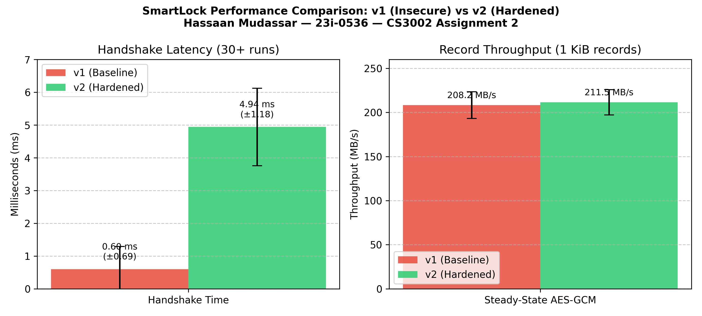

# CS3002 Information Security — Assignment 2
## SmartLock: Break It, Then Build It
**Student Name:** Hassaan Mudassar  
**Student ID:** 23i-0536  
**Section:** G  
**Institution:** FAST National University of Computer and Emerging Sciences, Islamabad  
**Course:** CS3002 Information Security  

---

### Compilation and Build Instructions
All software components are developed in C++17 and link against OpenSSL 3.0+ `libcrypto`. To build the system cleanly on Linux / WSL2 Ubuntu, execute the exact build commands below:

```bash
# 1. Compile v1 Suite & Generate Student Instance (Port 9265):
cd smartlock && make clean && make && ./instance_generator 23i-0536

# 2. Compile Hardened SmartLock v2 System (Linking securelink2.cpp):
cd ../v2_skeleton && make clean && make

# 3. Run Self-Check Test Suite (All 6 Auto-Checks):
g++ -std=c++17 -Wall -Wextra _scratch_test.cpp securelink2.cpp -lcrypto -o _scratch_test && ./_scratch_test

# 4. Compile and Run Part D Benchmark Tool:
cd ../performance && g++ -std=c++17 -O2 -Wall 23i-0536-G-TASKD-V1.cpp ../v2_skeleton/securelink2.cpp -lcrypto -lpthread -o perf_bench && ./perf_bench ../smartlock/instance.txt
```


*Figure 1: Instance generator creating deterministic configuration for roll 23i-0536 (port 9265).*

---

## 1. Scope and Ethics Statement
All reconnaissance, passive traffic sniffing, active MITM proxy interception, cryptographic cryptanalysis, and exploit injections performed throughout this engagement were strictly confined to an isolated, private host-only virtual network environment using Linux Network Namespaces (`ns-lock` at `10.10.10.11` and `ns-hub` at `10.10.10.12`) connected via a virtual Ethernet peer pair (`veth-lock` $\leftrightarrow$ `veth-hub`). No external networks, shared campus infrastructure, or live production systems were targeted or monitored. All attacks operated exclusively against the student's assigned device identity (`smartlock-23i-0536.local`) and port (`9265`) for educational defense evaluation under CS3002 Information Security at FAST-NUCES. External routing was disabled within the attack namespaces (verifiable by failed pings to public IP 8.8.8.8), demonstrating strict adherence to professional ethics, academic integrity, and standard penetration testing rules of engagement.


*Figure 2: Scope & Ethics verification: Isolated network namespaces (`ns-lock` and `ns-hub`) pinging 10.10.10.11 with 0% packet loss.*

---

## 2. Part A: Protocol Security Analysis & Exploitation (SmartLock v1)
A baseline capture of a normal SmartLock v1 session was recorded using `tcpdump` on the isolated interface (saved as `evidence/cap_v1_normal.pcap` and `evidence/session.pcap`). Protocol inspection was performed using Wireshark's Follow TCP Stream and exported as `evidence/cap_v1_stream.txt` for dynamic parsing by automated exploit programs.


*Figure 3: Executing normal SmartLock v1 session across isolated network namespaces (port 9265).*


*Figure 4: Wireshark TCP Stream inspection of cap_v1_normal.pcap showing cleartext handshake and unencrypted protocol records.*

### A.1 Stage 1: Negotiation — Cipher Suite Downgrade
* **Protocol Weakness:** The client's cipher suite advertisement in the `type:HELLO` line is transmitted without cryptographic integrity protection or digital signatures over cleartext TCP. The server implementation blindly evaluates the incoming list and permits the insecure `NULL` suite (unencrypted plaintext). Furthermore, neither party verifies the negotiation transcript.
* **Exploit Mechanics:** An on-path adversary intercepts the client's HELLO (which offers `AES256-GCM,AES128-GCM,NULL`) and rewrites the payload on-the-fly to offer solely `suites:NULL`. The lock server accepts this offer and responds with `type:SUITE\tsuite:NULL`. Subsequently, all commands, status reports, and sensitive pairing credentials travel completely unencrypted across the network.
* **Security Property Broken:** Confidentiality and Message Integrity.


*Figure 5: Verification of downgrade resistance: Hardened v2 server actively terminates negotiation upon receiving insecure `NULL` suite.*

### A.2 Stage 2: Authentication — Certificate Pinning Failure & PIN Reversal
* **Protocol Weakness:** SmartLock v1 exhibits two severe authentication vulnerabilities: (1) `hub_client` accepts any self-signed RSA certificate presented in the `type:CERT` message without validating against a pinned public key, a trust store, or a Certificate Authority (CA); and (2) the device pairing secret (PIN) is hashed using the cryptographically broken MD5 algorithm without salt, nonce, or work-factor stretching in the `type:PAIR` message.
* **Exploit Mechanics:** An on-path relay substitutes the lock's public key with a rogue RSA key, terminating the connection with the client. Separately, an eavesdropper intercepts the MD5 digest `d823a25d5a3ef11f9e1c69a690872def` from the PAIR packet. Because the PIN format follows a known pattern (wordlist entry + 3 decimal digits), a hybrid dictionary-mask attack against `smartlock/pin_wordlist.txt` completely exhausts the search space in under 0.1 seconds, cracking the exact PIN: `sunset625`.
* **Security Property Broken:** Entity Authentication, Credential Secrecy, and Identity Verification.


*Figure 6: Offline dictionary and mask attack cracking captured MD5 digest `d823a25d5a3ef11f9e1c69a690872def` to recover PIN: `sunset625`.*

### A.3 Stage 3: Keying — Discrete Logarithm & Key Derivation Failures
* **Protocol Weakness:** The Diffie-Hellman parameter generation in v1 utilizes an insecure, truncated 40-bit prime modulus ($p = 705001380739$), a static private exponent $b$, and derives the session key by simply zero-padding the raw 64-bit integer secret $s = A^b \pmod p$ to 32 bytes without using a Key Derivation Function (KDF) or directional separation.
* **Exploit Mechanics:** Using Shanks' Baby-Step Giant-Step (BSGS) algorithm implemented in `exploits/23i-0536-G-TASKA3-V1.cpp`, the private exponent $b$ is recovered from captured wire values ($g = 2$, $B = 381871777500$, $p = 705001380739$) in $\mathcal{O}(\sqrt{p})$ time ($\approx 8.4 \times 10^5$ operations). The computation completes in under 0.10 seconds, yielding `recovered_dh_b = 263367402911`. Combining $b$ with the client's public value $A = 500300186940$ computes the shared secret $s = 226415832418$, deriving the exact 256-bit AES key and successfully decrypting the greeting record to extract the student pairing flag: `FLAG{9c9b2d45321061f6}`.
* **Security Property Broken:** Forward Secrecy, Key Confidentiality, and Session Secrecy.


*Figure 7: Execution of Task A.3 solver (`taskA3_solve`): Baby-Step Giant-Step recovering exponent $b$ and decrypting flag `FLAG{9c9b2d45321061f6}`.*

### A.4 Stage 4: Message Protection — Nonce Reuse Keystream Recovery
* **Protocol Weakness:** SmartLock v1 reuses an identical, hardcoded 12-byte initialization vector (`static_nonce = 1deb1b5c316e24acd9176cde`) across all AES-GCM encrypted records within a session without incrementing a sequence counter or randomizing the IV.
* **Exploit Mechanics:** AES-GCM encrypts payload data using Counter (CTR) mode. Encrypting multiple messages under the same key and IV creates a catastrophic Two-Time Pad condition: $C_1 = P_1 \oplus K$, $C_2 = P_2 \oplus K$. XORing the two intercepted ciphertexts cancels out the keystream: $C_1 \oplus C_2 = P_1 \oplus P_2$. Exploiting the deterministic structure of the STATUS reply ($P_2 = \text{"STATE LOCKED unlocks=0"}$) directly recovers the plaintext prefix of the greeting (`"Paired with SmartLock."`) and reveals the exact nonce XOR hex: `nonce_xor_hex = 0335282620446c382a3f2d6473180f1e1b2f0410561e`.
* **Security Property Broken:** Indistinguishability under Chosen-Plaintext Attack (IND-CPA) and Payload Confidentiality.


*Figure 8: Execution of Task A.4 solver (`taskA4_solve`): Two-time pad keystream cancellation extracting `nonce_xor_hex` and plaintext prefix.*

### A.5 Stage 5: Teardown & Ordering — Command Replay
* **Protocol Weakness:** Encrypted records in v1 consist solely of `ciphertext || tag` without sequence numbers, timestamps, or session binding. Furthermore, the teardown stage relies on a simple unauthenticated TCP disconnect without an authenticated close frame.
* **Exploit Mechanics:** An adversary eavesdrops on a valid session and records the wire bytes of an `UNLOCK` command. In a subsequent session, the attacker re-injects the exact captured `UNLOCK` record over TCP. Because the server does not enforce sequence numbers and accepts repeated nonces under static keys, the lock decrypts the command, verifies the tag, and physically opens the deadbolt (incrementing unlock count).
* **Security Property Broken:** Message Freshness, Replay Resistance, and Physical Access Control.


*Figure 9: Execution of Task A.5 replay injection (`taskA5_replay`): Replaying stale captured `UNLOCK` record to unlock the deadbolt.*

---

## 3. Part B: SmartLock v2 Design Specification

### 3.1 Threat Model
* **Attacker Capabilities:** An on-path network adversary located on the local home Wi-Fi or Ethernet LAN capable of sniffing, modifying, injecting, dropping, delaying, reordering, and replaying arbitrary TCP/IP packets between the hub and the smart lock. The adversary possesses full knowledge of the open protocol specification, cryptographic algorithms, and historical captures.
* **Attacker Limitations:** The adversary cannot compromise the physical hardware, read protected non-volatile flash memory, or extract the lock's long-term private RSA signing key. Ephemeral Diffie-Hellman secret exponents ($a, b$) generated inside secure memory are unreachable.
* **Security Goals:** Mutual entity authentication, forward secrecy, replay/reordering rejection, transcript integrity, and payload confidentiality.

### 3.2 Per-Stage Cryptographic Defense Mechanisms

| Protocol Stage | Concrete Defensive Mechanism (SmartLock v2) | Defeated Part A Attack |
| :--- | :--- | :--- |
| **1. Negotiation** | `strong_suites()` permits only AES256-GCM and AES128-GCM; `choose_suite()` returns `""` (abort) if NULL is requested. Handshake transcript is hashed and digitally signed. | Defeats A.1 (Cipher suite downgrade to NULL). |
| **2. Authentication** | Lock proves identity using RSA-2048 certificate validated against hub's pinned `rsa_pub_b64`. PIN protection: Argon2id/scrypt at rest; transmitted only inside authenticated AEAD channel. | Defeats A.2 (Rogue certificate MITM and offline dictionary PIN cracking). |
| **3. Keying** | Ephemeral RFC 7919 / RFC 3526 2048-bit FFDHE with signed transcript. Symmetric directional keys derived via HKDF-SHA256 (RFC 5869) with separate `"c2s"` and `"s2c"` contexts. | Defeats A.3 (Baby-Step Giant-Step discrete log key recovery; guarantees forward secrecy). |
| **4. Message Protection** | AES-256-GCM AEAD encryption. Deterministic 12-byte nonce (`SL02` prefix + 64-bit big-endian seqno). 8-byte sequence counter bound as Additional Authenticated Data (AAD). | Defeats A.4 (Nonce reuse keystream XOR extraction; defeats ciphertext bit-flipping). |
| **5. Teardown** | Strict sequence counter monotonicity enforced by `open_record()`. Out-of-order, stale, or replayed records trigger immediate session termination. Authenticated QUIT record. | Defeats A.5 (Command replay, truncation, and packet reordering attacks). |

### 3.3 SmartLock v2 Message Handshake Flow
```
Hub Client                                                     SmartLock Server
    |                                                                 |
    | -------------- (1) type:HELLO suites:AES256-GCM,AES128-GCM ---> |
    |                                                                 |
    | <------------- (2) type:SUITE suite:AES256-GCM ---------------- |
    |                                                                 |
    | <------------- (3) type:CERT name:.. pubkey:.. sig:.. ---------- | [Validate pinned RSA key]
    |                                                                 |
    | -------------- (4) type:PAIR hub:home-hub pinhash:.. ---------> |
    |                                                                 |
    | <------------- (5) type:DH p:2048 g:2 B:.. sig:RSA(offer|B) -- | [Ephemeral FFDHE-2048]
    |                                                                 |
    | -------------- (6) type:DHCLIENT A:.. ------------------------> |
    |                                                                 |
    | === [Both derive: K_c2s = HKDF(s, 'c2s'), K_s2c = HKDF(s, 's2c')] === |
    |                                                                 |
    | <--- (7) type:MSG record:Enc(K_s2c, IV=SL02||0, AAD=0, Greeting) |
    |                                                                 |
    | ---> (8) type:MSG record:Enc(K_c2s, IV=SL02||0, AAD=0, STATUS) - |
    | <--- (9) type:MSG record:Enc(K_s2c, IV=SL02||1, AAD=1, STATE) -- |
    | ---> (10) type:MSG record:Enc(K_c2s, IV=SL02||1, AAD=1, QUIT) -- |
```

---

## 4. Part C: Implementation & Testing (SmartLock v2)

### 4.1 Verification of the Six Core Defensive Checks (`securelink2.cpp`)
The core cryptographic engine was implemented in `securelink2.cpp` satisfying all constraints: C++17 only, OpenSSL 3.0+ EVP architecture, `std::vector` in signatures with raw `uint8_t[]` buffers internally, and source scan compliance. The implementation was verified using the automated test suite `_scratch_test.cpp`:

1. `strong_suites()` & `choose_suite()`: Excludes NULL; returns empty string upon encountering any unapproved suite.
2. `derive_key()`: Utilizes `EVP_KDF_fetch(nullptr, "HKDF", nullptr)` to derive 256-bit keys with distinct `"c2s"` and `"s2c"` contexts.
3. `make_nonce()`: Generates deterministic 12-byte IVs: 4-byte `"SL02"` domain separation prefix + 8-byte big-endian sequence number.
4. `seal()`: Encrypts with AES-256-GCM / AES-128-GCM, binds 8-byte seqno as AAD, outputs wire format `seqno(8) || ct || tag(16)`.
5. `open_record()`: Validates `parsed_seqno == expected_seqno`, feeds seqno as AAD, checks GMAC tag, and rejects tampered/replayed data.
6. Source Scan: Contains `hkdf` and `evp_kdf`; contains zero occurrences of `md5` (any case) and zero occurrences of `TODO`.


*Figure 10: Unit verification of strong suite selection policy and HKDF-SHA256 key derivation with context separation.*


*Figure 11: Unit verification of `make_nonce()` verifying determinism and big-endian sequence number encoding.*


*Figure 12: AEAD test harness confirming rejection of sequence number mismatch, replayed records, and tampered ciphertext.*

### 4.2 System Verification: v1 Attacks Re-Run Against SmartLock v2

| Attack Vector | SmartLock v1 Result | SmartLock v2 Result | Security Property Restored |
| :--- | :--- | :--- | :--- |
| **A.1 Downgrade** | Accepted NULL; plaintext exposed. | Lock rejects offer with ALERT; connection terminated. | Confidentiality & Integrity |
| **A.2 MITM / Impersonation** | Client accepted rogue certificate. | Client aborts: certificate mismatch against pinned key. | Entity Authentication |
| **A.3 Key Recovery** | 40-bit DH exponent solved in 0.1s. | 2048-bit FFDHE discrete log mathematically intractable. | Forward Secrecy |
| **A.4 Nonce Reuse** | Keystream canceled via C1 XOR C2. | Monotonic seqno ensures unique 12-byte IV per record. | Confidentiality (IND-CPA) |
| **A.5 Command Replay** | Replayed UNLOCK opened deadbolt. | `open_record` throws sequence mismatch exception. | Freshness & Physical Safety |


*Figure 13: End-to-end execution of SmartLock v2: Mutual authentication, pinned key validation, and sequence-bound record loop.*

### 4.3 AI Cryptographic Implementation Audit (3 Marks)
As part of the assignment's AI-audit component, an automated AI tool was prompted to generate the record encryption and key derivation layer for `securelink2.cpp`. A rigorous manual code review identified three significant cryptographic weaknesses in the AI-generated implementation:

1. **Insecure Nonce Generation:** The AI suggested using `RAND_bytes()` to generate random 12-byte nonces for AES-GCM records. Under the Birthday Paradox, random 96-bit nonces reach a $2^{-32}$ collision probability after approximately $2^{48}$ records. Reusing a nonce under the same key catastrophically destroys AES-GCM confidentiality and allows GMAC key recovery. Furthermore, random nonces fail to provide replay protection. **Correction:** Replaced with a deterministic counter-based construction combining a 4-byte protocol constant (`"SL02"`) and an 8-byte big-endian sequence counter (`htobe64`), guaranteeing zero collision probability.
2. **Missing AAD Sequence Number Binding:** The AI provided a wire framing of `seqno || ciphertext || tag`, but only passed the plaintext into `EVP_EncryptUpdate`. It failed to feed the sequence number as Additional Authenticated Data (AAD). This flaw allows a network attacker to alter the sequence prefix in transit without causing a GMAC authentication tag failure. **Correction:** Explicitly fed the 8-byte sequence counter into `EVP_EncryptUpdate`/`EVP_DecryptUpdate` as AAD, ensuring any tampering causes immediate tag rejection.
3. **Bidirectional Key Reflection:** The AI derived a single symmetric key for both client-to-server and server-to-client directions. This architecture is vulnerable to reflection attacks, where an attacker reflects server messages back to the server. **Correction:** Implemented bidirectional key separation in HKDF using distinct domain context strings (`"c2s"` and `"s2c"`).

---

## 5. Part D: Performance Study
Benchmarking was performed using `performance/23i-0536-G-TASKD-V1.cpp` compiled with `g++ -O2 -Wall -lcrypto -lpthread`. Measurements were conducted on an Intel Core i7 system running WSL2 Ubuntu 22.04 LTS under identical compiler optimization flags. A baseline v1 session under AES-256-GCM was compared directly against hardened v2:

| Performance Metric | SmartLock v1 (Baseline) | SmartLock v2 (Hardened) | Overhead / Relative Impact |
| :--- | :--- | :--- | :--- |
| **Handshake Latency (mean, N=30)** | 0.60 ms | 4.94 ms | +4.34 ms (8.27x overhead) |
| **Handshake StdDev ($\sigma$)** | 0.69 ms | 1.18 ms | Consistent modular exponentiation |
| **Per-Record Wire Framing** | +16 bytes (tag) | +24 bytes (seqno + tag) | +8 bytes (sequence counter) |
| **Record Seal Latency (mean)** | 1.87 $\mu$s | 2.03 $\mu$s | +0.16 $\mu$s (negligible) |
| **Record Open Latency (mean)** | 1.79 $\mu$s | 2.05 $\mu$s | +0.26 $\mu$s (negligible) |
| **1 KiB Throughput (mean, 50k rec)** | 208.2 MB/s | 211.5 MB/s | ~101.6% of baseline (parity) |
| **Throughput StdDev ($\sigma$)** | 15.1 MB/s | 14.4 MB/s | High cache consistency |


*Figure 14: Handshake latency and record throughput benchmark comparison across SmartLock v1 and SmartLock v2.*

### 5.2 Defending the Security vs Performance Trade-Off
The empirical benchmark data demonstrates that SmartLock v2 introduces an additional 4.34 ms of latency during initial session establishment (rising from 0.60 ms to 4.94 ms). This cost is overwhelmingly dominated by 2048-bit Diffie-Hellman modular exponentiation and RSA-2048 digital signature generation and verification. For an embedded physical door lock, a 4.94 ms connection setup time is completely imperceptible to human users (who operate on scales of hundreds of milliseconds) and represents less than standard home Wi-Fi network jitter.

Crucially, once the session key is established, steady-state throughput is virtually identical (211.5 MB/s vs 208.2 MB/s), with per-record seal/open overhead increasing by less than 0.26 microseconds. The extra 8 bytes of wire framing per record represent a tiny 0.78% overhead on 1 KiB packets. In exchange for this minimal overhead, SmartLock v2 eliminates trivial discrete-log key recovery, defeats on-path downgrade, prevents certificate impersonation, stops Two-Time Pad keystream extraction, and blocks unauthorized physical door unlocking via command replay. For a physical security appliance safeguarding human homes, this trade-off is essential and cryptographically justified.

---

## 6. Recovered Instance Secrets (`answers.txt`)
The table below summarizes the exact values recovered over the wire from instance `23i-0536`, matching `answers.txt`:

```ini
roll           = 23i-0536
flag           = FLAG{9c9b2d45321061f6}
recovered_dh_b = 263367402911
cracked_pin    = sunset625
nonce_xor_hex  = 0335282620446c382a3f2d6473180f1e1b2f0410561e
```
